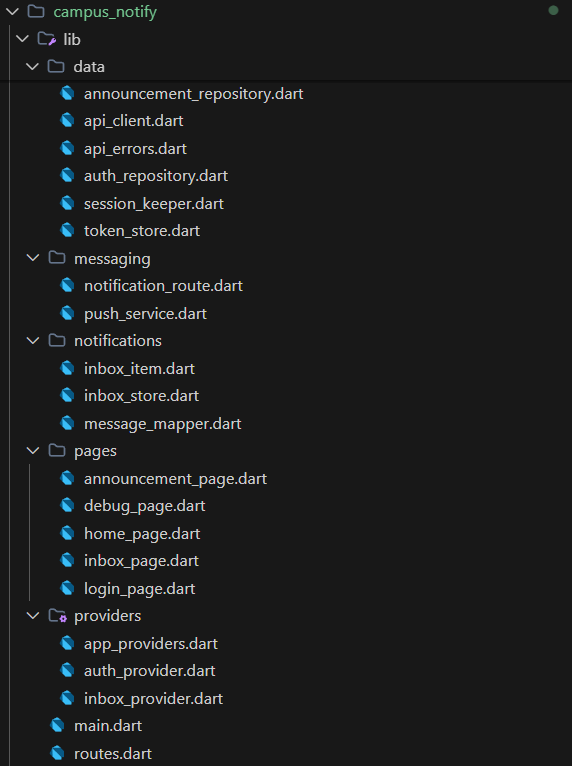
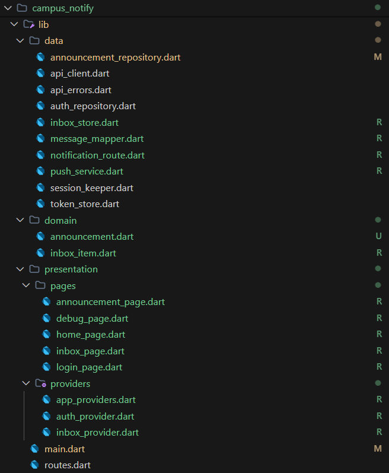

# Laporan Refactor Struktur: Layer-First

## Ringkasan

Struktur `lib/` diubah dari pembagian **per tipe berkas** menjadi pembagian
**per lapisan** (`data`, `domain`, `presentation`). Perubahan ini murni
struktural: tidak ada nama kelas, signature, atau perilaku aplikasi yang
diubah. `flutter analyze` bersih dan seluruh 55 tes lulus tanpa satu pun
penyesuaian logika.

## Kondisi awal

Sebelum refactor, `lib/` dibagi menjadi lima folder yang mencampur konsep
lapisan dengan konsep tipe berkas:

```
lib/
├── data/          enam berkas: klien HTTP, token, sesi, error
├── messaging/     push_service + notification_route
├── notifications/ inbox_item + inbox_store + message_mapper
├── pages/         lima halaman
├── providers/     tiga berkas state Riverpod
├── main.dart
└── routes.dart
```



Masalah yang membuat struktur ini sulit dijelaskan sebagai layer-first:

1. `providers/` berisi state presentasi (Riverpod), tetapi `InboxRepository`
   justru tinggal di `notifications/`. Satu lapisan tersebar di dua folder.
2. `messaging/` mencampur infrastruktur (`push_service`, yang butuh Firebase dan
   plugin platform) dengan fungsi murni yang mudah diuji
   (`notification_route`, `message_mapper`).
3. `class Announcement` (entitas) menempel di dalam berkas repository. Satu
   berkas memuat dua tanggung jawab.

## Yang dikerjakan

### 1. Menambah lapisan `domain/`

Dua entitas murni dipindahkan ke sini. Keduanya tidak mengimpor Flutter,
HTTP, maupun JSON:

- `domain/inbox_item.dart` (dari `notifications/`)
- `domain/announcement.dart` (baru — diekstrak dari `data/announcement_repository.dart`)

### 2. Menyatukan lapisan `data/`

Semua akses ke sumber data kini di satu tempat: HTTP, secure storage,
SharedPreferences, pemetaan payload FCM, dan service push.

### 3. Menyatukan lapisan `presentation/`

Halaman dan state Riverpod dikelompokkan di bawah satu induk, dengan
subfolder `pages/` dan `providers/`.

### 4. Memisahkan entitas dari repository

`Announcement` dipindah ke `lib/domain/announcement.dart`;
`AnnouncementRepository` tetap di `lib/data/` dan mengimpor entitas tersebut.
Tidak ada perubahan pada data contoh maupun cara `byId()` bekerja.

### 5. Memperbaiki import

Import relatif diperbarui di `main.dart`, seluruh berkas yang dipindah, dan
10 berkas di `test/`. Perubahan hanya pada baris `import`, bukan isi tes.

### 6. Memperbarui dokumentasi

`README.md` (tabel fitur dan struktur folder), `docs/panduan-belajar.md`,
`docs/praktikum-3-implementasi.md`, `docs/verifikasi-ai.md`, dan
`screenshots/README.md` disesuaikan dengan path baru.

## Pemetaan berkas

Sebanyak 13 berkas dipindahkan, 1 berkas baru dibuat, dan 1 berkas diubah
isinya (pemisahan entitas).

| Sebelum | Sesudah |
| --- | --- |
| `lib/notifications/inbox_item.dart` | `lib/domain/inbox_item.dart` |
| `lib/data/announcement_repository.dart` (class `Announcement`) | `lib/domain/announcement.dart` (berkas baru) |
| `lib/notifications/inbox_store.dart` | `lib/data/inbox_store.dart` |
| `lib/notifications/message_mapper.dart` | `lib/data/message_mapper.dart` |
| `lib/messaging/notification_route.dart` | `lib/data/notification_route.dart` |
| `lib/messaging/push_service.dart` | `lib/data/push_service.dart` |
| `lib/pages/announcement_page.dart` | `lib/presentation/pages/announcement_page.dart` |
| `lib/pages/debug_page.dart` | `lib/presentation/pages/debug_page.dart` |
| `lib/pages/home_page.dart` | `lib/presentation/pages/home_page.dart` |
| `lib/pages/inbox_page.dart` | `lib/presentation/pages/inbox_page.dart` |
| `lib/pages/login_page.dart` | `lib/presentation/pages/login_page.dart` |
| `lib/providers/app_providers.dart` | `lib/presentation/providers/app_providers.dart` |
| `lib/providers/auth_provider.dart` | `lib/presentation/providers/auth_provider.dart` |
| `lib/providers/inbox_provider.dart` | `lib/presentation/providers/inbox_provider.dart` |

## Kondisi akhir

```
lib/
├── main.dart
├── routes.dart
├── domain/
│   ├── announcement.dart
│   └── inbox_item.dart
├── data/
│   ├── api_client.dart
│   ├── api_errors.dart
│   ├── announcement_repository.dart
│   ├── auth_repository.dart
│   ├── inbox_store.dart
│   ├── message_mapper.dart
│   ├── notification_route.dart
│   ├── push_service.dart
│   ├── session_keeper.dart
│   └── token_store.dart
└── presentation/
    ├── pages/       login, home, inbox, announcement, debug
    └── providers/   auth_provider, inbox_provider, app_providers
```



Arah dependensi menjadi satu arah:

```
presentation  →  domain  ←  data
```

`presentation` boleh mengenal `domain` dan `data` (lewat provider).
`data` hanya mengenal `domain`. `domain` tidak mengenal keduanya.

## Verifikasi

```
flutter analyze   →  No issues found!
flutter test      →  All tests passed! (55 tes)
```

Bukti terminal: 
dan .

Angka `+55` penting: jumlah tes harus sama dengan sebelum refactor, bukan
lebih sedikit. Tes yang dihapus tentu juga akan menghasilkan "All tests
passed", jadi yang membuktikan refactor tidak melemahkan pengujian adalah
selisih baris berikut.

| Berkas tes | Baris berubah |
| --- | --- |
| `test/app_test.dart` | 3 |
| `test/auth_notifier_test.dart` | 1 |
| `test/inbox_format_test.dart` | 1 |
| `test/inbox_notifier_test.dart` | 3 |
| `test/inbox_repository_test.dart` | 2 |
| `test/message_mapper_test.dart` | 1 |
| `test/notification_config_test.dart` | 1 |
| `test/notification_route_test.dart` | 1 |
| `test/push_service_test.dart` | 1 |
| `test/support/fakes.dart` | 2 |

Seluruh perubahan itu berada di baris `import`. Tidak ada satu pun `expect`
yang disentuh, sehingga lulusnya 55 tes menunjukkan perilaku aplikasi tetap,
bukan tes yang dilonggarkan.

Pemeriksaan tambahan: pencarian ulang `lib/` dan `test/` tidak menemukan lagi
import yang menunjuk `notifications/`, `messaging/`, `pages/`, atau
`providers/` sebagai folder tingkat atas.

## Keputusan yang perlu dijelaskan

**`routes.dart` tetap di `lib/`, bukan dipindah ke `presentation/`.** Berkas
ini dipakai oleh `data/notification_route.dart` untuk menormalkan deep link.
Kalau dipindah ke `presentation/`, lapisan data akan mengimpor lapisan
presentasi dan arah dependensi terbalik.

**`test/notification_config_test.dart` tidak dipindah.** Tes ini membaca
`AndroidManifest.xml` langsung dari disk, bukan lewat paket, jadi lokasinya
tidak terpengaruh struktur `lib/`. Yang berubah hanya import `push_service`.

**`docs/ai-challenge/02-draf-awal-ai.md` sengaja tidak diubah.** Berkas itu
transkrip historis draf AI beserta kegagalannya, bukan dokumentasi struktur
aktif. Menulis ulang path di dalamnya akan merusak catatan audit.

## Yang tidak berubah

- Nama kelas, fungsi, dan signature publik.
- Perilaku runtime: notifikasi, deep link, guard route, kotak masuk.
- Isi `pubspec.yaml` dan dependensi.
